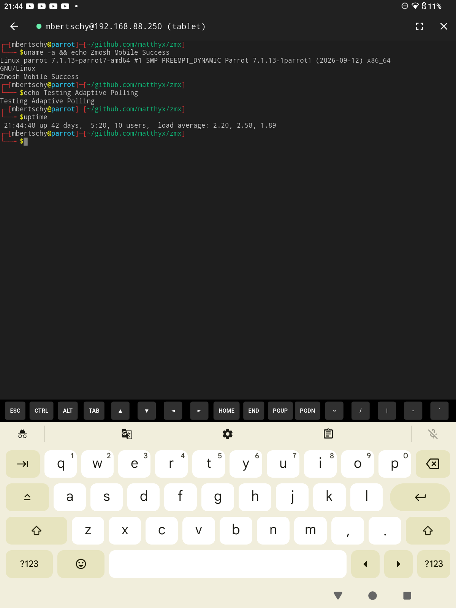

# zmosh-app

Mobile client for the [**zmosh**](https://github.com/matthyx/zmosh) roaming gateway and [**zmx**](https://github.com/neurosnap/zmx) terminal multiplexer.

Built with **Flutter**, [**xterm.dart**](https://pub.dev/packages/xterm), and high-performance native UDP roaming via [**libzmosh**](https://github.com/matthyx/zmosh).

<p align="center">
  
</p>

---

## Overview

Traditional SSH connections on mobile devices frequently drop when switching between Wi-Fi and cellular networks or when waking a phone from sleep. `zmosh` solves this problem by using an encrypted, authenticated UDP roaming protocol over `libzmx`.

`zmosh-app` provides a native, cross-platform mobile interface:
- **Resilient Mobile Shell**: Seamlessly transitions between Wi-Fi and 4G/5G without terminating running jobs or breaking terminal state.
- **Embedded C Engine**: Uses precompiled `libzmosh.so` via Dart FFI with zero runtime dependencies.
- **SSH Bootstrapping**: Automatically dials your server over SSH, starts `zmosh serve <session>`, retrieves the ephemeral UDP port and crypto key, and handshakes over UDP.
- **Hardware & Touch Terminal**: Powered by `xterm.dart` with support for high DPI displays, virtual modifier keys (`Ctrl`, `Alt`, `Esc`, `Tab`, directional arrows), and dynamic resize synchronization.

---

## Architecture

```
┌──────────────────────────────────────────────┐
│                  zmosh-app                   │
│                                              │
│   ┌──────────────────────────────────────┐   │
│   │        Flutter UI (xterm.dart)       │   │
│   └──────────────────┬───────────────────┘   │
│                      │ Dart FFI              │
│   ┌──────────────────▼───────────────────┐   │
│   │              libzmosh.so             │   │
│   │  (ChaCha20-Poly1305 + UDP Roaming)   │   │
│   └──────────────────┬───────────────────┘   │
└──────────────────────┼───────────────────────┘
                       │ UDP (ephemeral port)
                       ▼
┌──────────────────────────────────────────────┐
│                 Remote Host                  │
│                                              │
│   ┌──────────────────────────────────────┐   │
│   │             zmosh serve              │   │
│   └──────────────────┬───────────────────┘   │
│                      │ Unix Domain Socket    │
│   ┌──────────────────▼───────────────────┐   │
│   │              zmx daemon              │   │
│   └──────────────────────────────────────┘   │
└──────────────────────────────────────────────┘
```

---

## Native Shared Libraries (`libzmosh.so`)

The prebuilt native libraries are located in:
```
android/app/src/main/jniLibs/
├── arm64-v8a/libzmosh.so
├── armeabi-v7a/libzmosh.so
└── x86_64/libzmosh.so
```

To recompile them from [`matthyx/zmosh`](https://github.com/matthyx/zmosh):
```bash
git clone https://github.com/matthyx/zmosh.git
cd zmosh
zig build android-lib -Doptimize=ReleaseSafe
```

---

## Building and Testing on Real Devices

### Prerequisites
- [Flutter SDK](https://flutter.dev) (>= 3.10.0)
- Android SDK & `adb`

### Run on Connected Android Device or Tablet
```bash
# Verify device connection
adb devices

# Install dependencies and launch
flutter pub get
flutter run -d <device-id>
```

### Build Release APK
```bash
flutter build apk --release
# Output APK: build/app/outputs/flutter-apk/app-release.apk

# Install on tablet:
adb install build/app/outputs/flutter-apk/app-release.apk
```

---

## License

MIT
